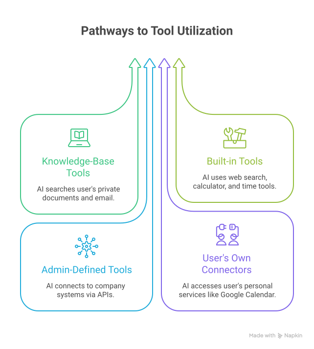
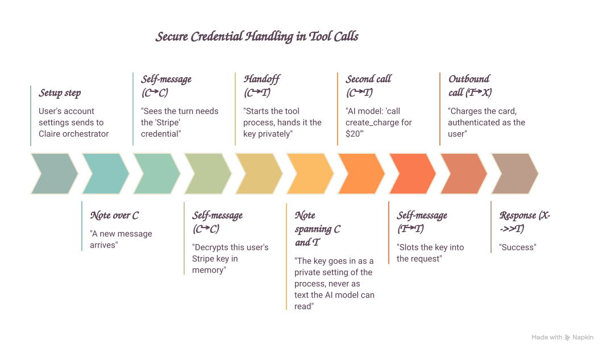

# Can You Trust Claire With Your Accounts?

If you've used ChatGPT you already have a sense of what an AI assistant can do — answer questions, search the web, take action on your behalf. Clairify's assistant, Claire, works the same way, but built specifically for executive leadership: it acts as your Chief of Staff, handling things like your
inbox, calendar, and connections to your business-critical SaaS.

Because sensitive data may be flowing through Clairify we hold Claire to the same standard as any other person on your team. To that end:

1. It's given only the specific scopes and permissions it needs to do its job, nothing more — the same access-control principle you'd apply to a new hire or contractor. And because Claire only ever acts as *you*, never as itself, it can never reach beyond what you personally have access to.
1. Claire never actually sees your passwords or API keys, because it doesn't need to see them to use them — which protects against credential leakage, unauthorized actions, and malicious prompts.

---

## Claire only has the access you give it

### What can Claire actually reach?

Every action Claire takes falls into one of three places: your own documents and email, the public web, or a business app you or your company has connected — things like your CRM, your calendar, or your billing system.

{width="60%" class="no-caption"}

Your documents and email stay yours. During normal operation, no other Clairify customer, no other person at your company, and no one on the Clairify team, sees your data via Claire.

!!! tip "Zero-operator access"

    This is what's known as **zero-operator access**: no human at Clairify can see your data. Claire may still send your content to the sub-processors it relies on to function, like the underlying AI model provider (OpenAI, Google, etc.), the same way any AI assistant does — but no person ever looks at it along the way.

### Who decides what it's allowed to touch, and can that change?

Access to any given app is switched on or off by your organization's admin, or by you personally for the accounts you've connected yourself. Whatever you decide takes effect immediately — starting with your very next message to Claire.

### Why can't it act as someone else?

Every request Claire makes on your behalf is tied to your real, verified identity — the same login you use for Clairify itself. Even if a message tried to instruct it to act as somebody else, that instruction is ignored: Claire always uses the identity of whoever it's actually talking to, and nothing else.

---

## Claire never sees your passwords or keys

### How does it use an app it doesn't have the password to?

When you connect an account — say, Stripe or your CRM — that credential is encrypted the moment you save it. From that point on, it's only ever unlocked, briefly, inside Clairify's own engine, and only at the exact moment it's needed.

{width="80%" class="no-caption"}

Here's what that looks like end to end:

1. You connect the account once, in your settings. The key is encrypted immediately.
2. When you send Claire a message that needs it, the key is unlocked — just for that moment, just for you.
3. It's handed directly to the part of the system that actually makes the request. Claire, the AI itself, never reads it.
4. Claire only asks for the business details — an amount, an order number — never the credential.
5. The request goes out, authenticated as you.
6. Claire only ever sees the outcome — "charge succeeded," "here are the matching invoices" — never the key that made it happen.

### What if a connection isn't set up or has expired?

Nothing is attempted. Claire simply lets you know the connection needs to be made (or remade) in your settings, the same way it would tell you it can't do something it doesn't have permission for.

### Could a malicious email trick it into leaking a key?

No — because the key is never somewhere Claire can read it, there's nothing for a trick instruction to grab. A cleverly worded message buried in an email can't make Claire hand over something it never had access to in the first place.

### How does Claire defend against prompt injection?

Everything Claire is about to send to its AI model is first screened for hidden instructions by a purpose-built classifier. See [How Claire Defends Against Prompt Injection](prompt-injection.md) for how it works and where it sits in the pipeline.

### Is my connection separate from everyone else's?

Yes. Each person's connected accounts are kept completely separate, both from other people at your company and from every other Clairify customer. And once a key is stored, even we can't read it back out in plain form — it can only be unlocked for that one moment of use, by you.
