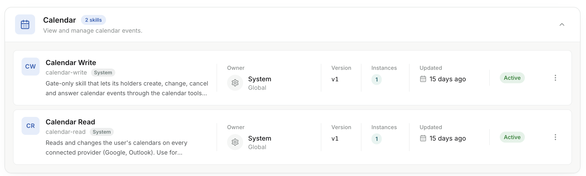

# How Claire Protects Against Excessive Agency

!!! tip "Go to the source"

    Excessive agency is #3 on the OWASP Top 10 for LLM Applications (2026), up from #3 in 2025. See [LLM03: Excessive Agency](https://genai.owasp.org/resource/owasp-genai-llm-top-10-2026/) for vulnerability examples, attack scenarios, and mitigations.

We call Claire and AI _assistant_, but that refers to the app you interact with as a user. In engineering parlance Claire is an _agent_. [Langchain](https://www.langchain.com/blog/what-is-an-agent) defines an agent as a system that uses a LLM to decide the control flow of an application. So rather than producing only text, the model chooses the next step. 

So how is the agent able to choose the next step? Like this:

1. You ask the LLM a question. For example, "What's the weather today?"
2. Along with your question, we send the model a list of things it's allowed to do to help it generate the answer. For example, "Check The Weather" and "Check The Time."
4. A reasoning model will understand that it needs information it doesn't have, i.e., the weather report, and return "Check The Weather."
5. We get that back, map it to an API call to weather.com, and send the current weather report back to the LLM.
6. The model uses the results to generate its final answer.

"Check The Weather" is called a _tool_, and when we call weather.com, that's called a _function call_. That's it for definitions. But the important thing to note: We execute the API call with code that we write. The LLM's job is only to choose the right tool. Sometimes we talk like the model doing stuff when it's really not, but roll with it.

## Excessive Agency

So now we get to the part about excessive agency. We have to treat the model like a real person and that involves applying the concept of _least priviledge_. Every person in your company should have only the minimum permissions required to do their job. When this concept is applied to the model, it means that if model needs to send an email, it shouldn't also have the ability to delete email.

!!! tip "Who cares?"
    The reason any of this is important is that in the case that the LLM makes stuff up, or a prompt injection attack, the following safeguards minimize the damage.

## Excessive Functionality

The agent could have more functionality than it needs in three ways:

1. The agent has access to superfluous tools.
2. An individual tool bundles many permissions.
3. The permission given by the tool is open ended.

The first is solved by layering least privilege: First, admins must enable tools for the Claire instance. This action makes a list of tools available in Clairify The App. Then, each user must enable tools they want in Clairify The App.

The second is solved in the way tools are defined: We don't bundle permisssions. Read is separated from write. Draft is separated from send. And you can inspect every enabled tool in the tool library so you don't have to take our word for it.

Third, Claire interacts with all downstream systems through API endpoints. Each endpoint is typically narrowly defined, meaning it allows a specific action on a set of resources. However, it's designed entirely by the 3rd-party and so narrow scoping on their side is not guaranteed. Most importantly, Claire treats _itself_ as a downstream system. Therefore it could never access its own shell to directly execute a command. 

{width="80%" class="no-caption on-glb"}

!!! warning "Turn off tools"
    Users are responsible for turning off tools that are not in use. Admins are responsible for turning off tools that have not been used by anyone on the instance.

## Excessive Permissions

Tools are keyed to the identity of the current user, never to the model or another user. So whenever interacting with a downstream system, Claire can perform actions according to the user's permissions on that system. For example, if a developer, Joe's, asks Claire to merge a pull request, Claire can use the merge tool, but Github will still block if the merge protection rules aren't met. See [Claire only has the access you give it](ai-safety.md#claire-only-has-the-access-you-give-it).

## Excessive autonomy

High-impact actions happen without a person checking them first.

* **Skill gating** — A tool can be restricted so that Claire offers it only when a specific skill is in use.
* **Versioned and verifiable** — Every tool version is published from a fixed manifest with a checksum, so administrators know exactly what is running on each instance.